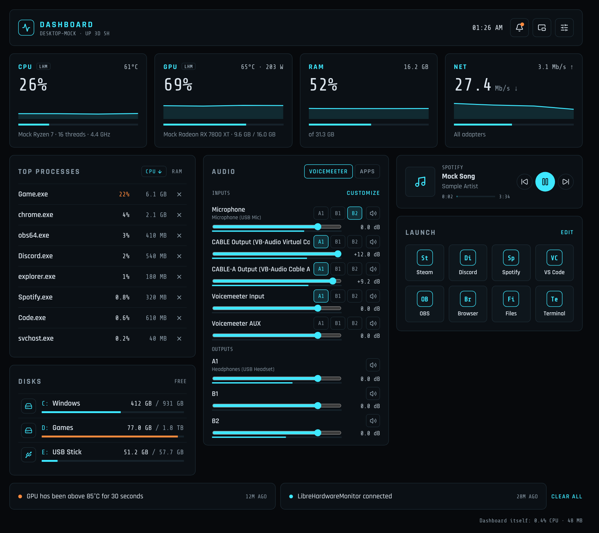
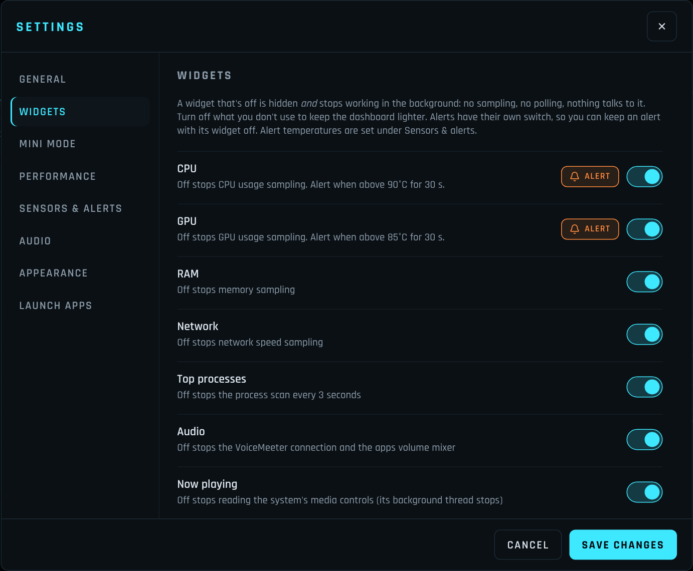
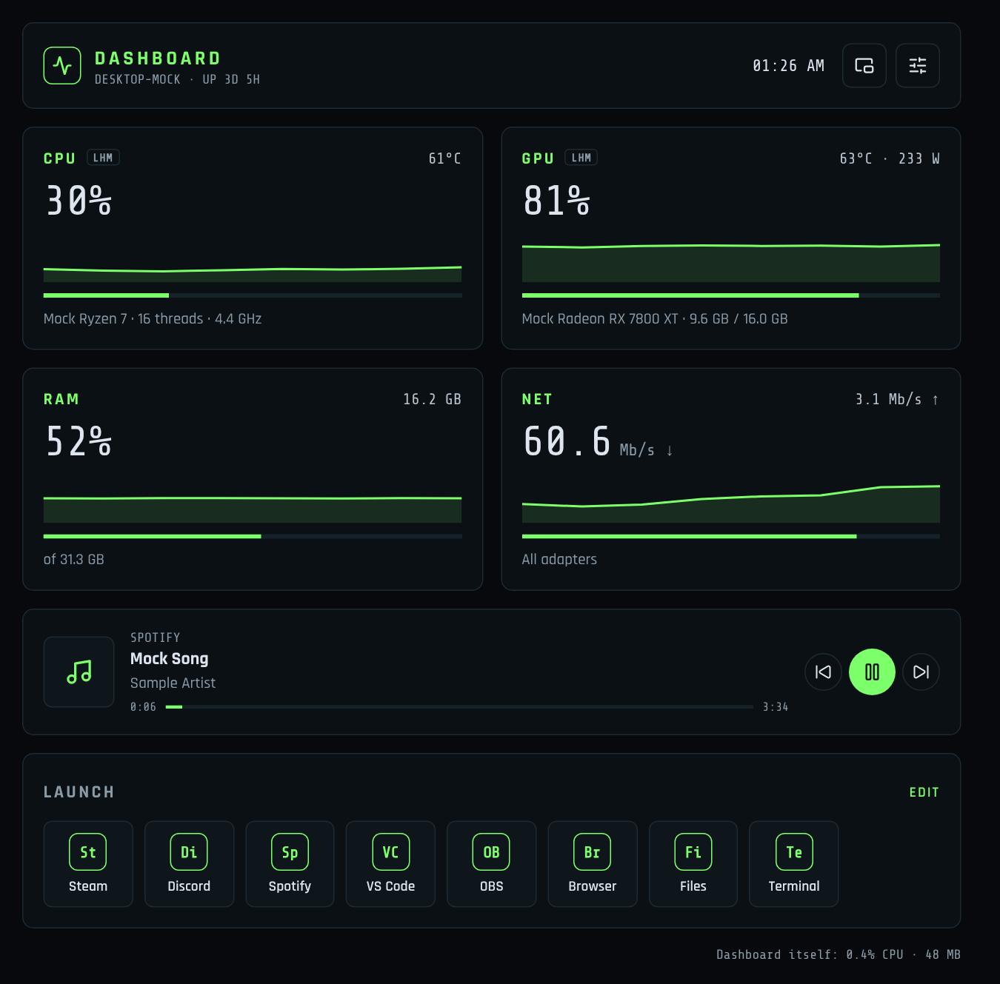
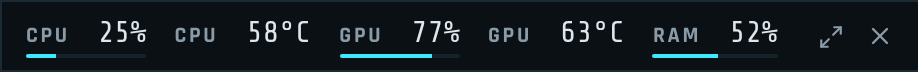
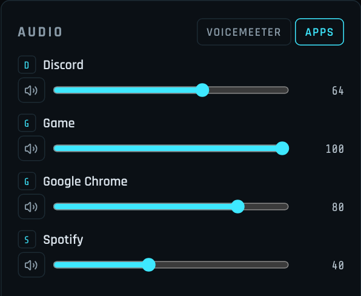
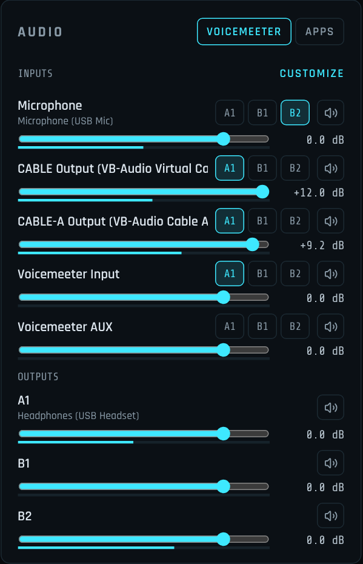
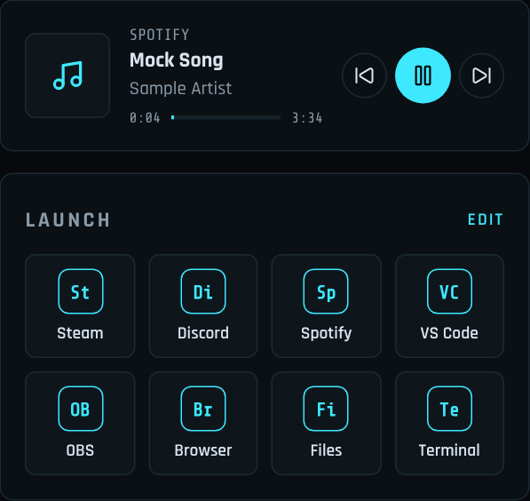

# Personal Dashboard

**A small, fast system dashboard for Windows and Linux.** It shows your PC's vitals, controls your audio and music, and launches your apps from one window. It's light enough to leave open while you game.

Screenshots use the app's built-in sample data.

## What it does

- **Live stats:** CPU, GPU, RAM and network usage with temperatures and a minute of history, so you can see a spike coming.
- **Top processes:** the 8 busiest programs, with an × to end one that's misbehaving (it asks first).
- **Audio:** a volume mixer for every app that's playing sound, and if you use VoiceMeeter, a simpler control panel for it.
- **Now playing:** what's playing in Spotify, your browser or any media app, with album art and play/pause/skip.
- **Launcher:** one-click buttons for the apps and links you use most.
- **Mini mode:** a small always-on-top strip with just the readings you pick, for a second monitor or over a game.
- **Disks:** every drive with its free space; click one to open it in File Explorer.
- **Alerts:** a Windows notification when your CPU or GPU runs hot for 30 seconds.
- **Yours to trim:** switch off anything you don't use. A switched-off widget is hidden *and* stops running in the background.

### Built to stay out of your way

The dashboard measures its own CPU and memory use and shows it at the bottom of the window, so you can always see what it costs.

- **In the tray, it nearly sleeps.** It only reads the temperatures your alerts and the tray tooltip need, and nothing at all if those are off.
- **During fullscreen games** it switches to a lighter mode: fewer updates and no graphs.
- **Switched-off widgets cost nothing:** no sampling and no background work.
- **It's private.** Everything stays on your PC: the window talks only to the app itself. The only time it goes online is to check for new versions. Fonts and everything else ship with the app.

## Install

**You need** Windows 10 or 11 (64-bit) and the Microsoft Edge WebView2 Runtime, which is already on Windows 11 and up-to-date Windows 10.

1. Download the latest **`DashboardSetup-….exe`** from [Releases](https://github.com/PacketLoss935/dashboard-releases/releases/latest).
2. Run it. Windows may show *"Windows protected your PC"* because the installer isn't code-signed. Click **More info › Run anyway**.
3. It installs just for your user. There's no admin prompt, and you get a Start menu shortcut.

That's it. The dashboard opens, and a tray icon appears next to the clock.

### Linux

**You need** a 64-bit distro from the last few years (Ubuntu 22.04+, Debian 12, Fedora 36+, Arch, ...). Nothing else to install: the window, Python and everything else are inside the file.

1. Download the latest **`Dashboard-…-x86_64.AppImage`** from [Releases](https://github.com/PacketLoss935/dashboard-releases/releases/latest).
2. Make it executable: right-click › Properties › *Allow executing as program*, or `chmod +x Dashboard-*.AppImage`.
3. Run it. Keep it somewhere you own (like `~/Applications`) so it can update itself.

If it doesn't start, your system is missing FUSE 2, which AppImages use to open themselves. On Arch: `sudo pacman -S fuse2`; on Ubuntu: `sudo apt install libfuse2`. Or run it with `--appimage-extract-and-run`.

Audio works with PipeWire or PulseAudio, Now playing with any player that supports MPRIS (Spotify, Firefox, Chrome, VLC, ...; Spotify's album art isn't shown, since that would mean downloading it). The tray icon shows on KDE, Cinnamon, XFCE and most others; **stock GNOME** needs the *AppIndicator and KStatusNotifierItem Support* extension, and without it closing the window quits the app. On Wayland the desktop decides where windows open, so the remembered position may be ignored (the size is kept).

## Using it

| | |
|---|---|
| **Open it** | Start menu › *Dashboard*, or click the tray icon. |
| **Close it** | The × hides it to the tray, where it keeps watching temperatures (you can turn that off in Settings › General). To exit, right-click the tray icon › **Quit**. |
| **Temps at a glance** | Hover the tray icon to see CPU and GPU temperatures without opening the window (Settings › Sensors & alerts). |
| **Where it opens** | Where you left it: same size, same monitor, maximized or not. If that monitor is unplugged, it opens centered. |
| **Settings** | The sliders icon, top right. |
| **Start with Windows** | Settings › General › *Start with Windows*. You can also choose to start hidden in the tray. |

### Choose your widgets

**Settings › Widgets** has a switch for every part of the dashboard. Turning one off removes it and stops everything behind it, so a trimmed-down dashboard is a lighter one too.

The CPU and GPU temperature **alerts have their own switch** (the bell), so you can hide a tile and still get warned if things run hot. Set the temperatures under **Settings › Sensors & alerts**.

A compact setup with processes and audio switched off, and the green accent color (Settings › Appearance).

### Mini mode

Click the **mini mode** button at the top of the dashboard (or **Mini mode** in the tray icon's menu) to swap the dashboard for a small strip that stays on top of other windows: handy on a second monitor, or over a game running in borderless or windowed mode. Drag it anywhere; it reopens in the same spot. Clicking it doesn't take focus away from your game.

Choose what it shows in **Settings › Mini mode**: CPU and GPU usage and temperatures, GPU power and memory, RAM, network speed, Now playing and a clock, in any order (drag to reorder), as a strip or a column, with or without usage bars. While it's open the full dashboard is closed, so only those readings are measured. Temperatures turn orange near your alert limit.

The **⤢** button brings the dashboard back; **×** hides everything in the tray.

### Audio

The **Apps** tab lists every app that's playing sound, each with its own volume and mute, on whatever device it plays to. It's like the Windows volume mixer, but all in one list. Double-click a slider to reset it (100 for apps, 0 dB in the VoiceMeeter mixer).

Want an app on a different output, such as Discord on your headset and a game on speakers? Turn on **Settings › Audio › Let me change an app's output device**, and a device picker appears next to each app.

 

**Using VoiceMeeter?** (Standard, Banana or Potato.) The Audio panel gets a **VoiceMeeter** tab with a fader, mute and routing buttons (A1, B1…) for each input, faders for the outputs, and live level meters. VoiceMeeter still does the audio, so keep it running (minimized is fine). Changes made in either window show up in both. Choose which strips appear with **Customize**.

 

### Now playing and the launcher

**Now playing** works with anything that shows up in Windows' media controls: Spotify, YouTube in your browser, media players and so on. Use the buttons to skip or pause without switching windows.

**Launcher:** click **Edit** to add your own apps, and drag the handle next to each one to change the order (the top app comes first). Right-click a tile to **open its file location** or **run it as administrator**. A target can be a program (`notepad.exe`), a full path, a shortcut (`.lnk`) or a link like `steam://open/main`. Icons come from the apps themselves.

 

### CPU temperature (optional)

Windows doesn't let normal apps read the real CPU temperature, so that one reading needs the free [LibreHardwareMonitor](https://github.com/LibreHardwareMonitor/LibreHardwareMonitor) (`winget install LibreHardwareMonitor.LibreHardwareMonitor`):

1. Run it **as administrator** and turn on **Options › Remote Web Server › Run**.
2. Optional: *Start Minimized*, *Minimize to Tray* and *Run On Windows Startup*, so you never think about it again.

Everything else (GPU usage and temperature, RAM, network, processes) works without it. Tiles show a small **NV**, **LHM** or **WIN** tag for where their numbers come from. NVIDIA cards get exact numbers (including power draw) straight from NVIDIA's driver, with nothing extra to install. If you have more than one GPU, pick the one to show in **Settings › Sensors & alerts**.

## Updates

The dashboard can update itself: when a new version is out you'll see **Update available › Install & restart**. It downloads the installer, checks it hasn't been tampered with, installs it and reopens, and your settings are kept.

There's nothing to set up: it checks for a new version every 6 hours, or whenever you click **Check now** in **Settings › General › Updates**. No account or sign-in is involved. After an update, a short **What's new** card lists the changes (also under **Settings › General › Updates › What's new**).

On Linux this works when the AppImage is in a folder you own, like `~/Applications`: the new version replaces the file in place.

## Troubleshooting

- **"Windows protected your PC" when installing:** expected for unsigned apps. Click **More info › Run anyway**.
- **No CPU temperature:** see [CPU temperature](#cpu-temperature-optional); LibreHardwareMonitor must run as administrator with its web server on.
- **The wrong GPU is shown:** choose yours in **Settings › Sensors & alerts**.
- **An app won't switch output device:** some apps only switch after their audio restarts. Pause and play again.
- **Linux: the AppImage won't open:** install FUSE 2 (see [Linux](#linux)) or run it with `--appimage-extract-and-run`.
- **Linux: no tray icon on GNOME:** install the AppIndicator extension.
- **Something else:** the log is at `%APPDATA%\PersonalDashboard\dashboard.log` (Linux: `~/.config/PersonalDashboard/dashboard.log`), and settings are in `settings.json` next to it.

**Uninstall** from Windows *Settings › Apps* (Linux: delete the AppImage, and `~/.config/autostart/personal-dashboard.desktop` if you turned on start with login). Your settings stay in `%APPDATA%\PersonalDashboard`; delete that folder too for a clean slate.

---

Free to use; see [LICENSE](LICENSE). The app is built with open-source software, credited in `THIRD_PARTY_NOTICES.txt`, which comes with every download.
